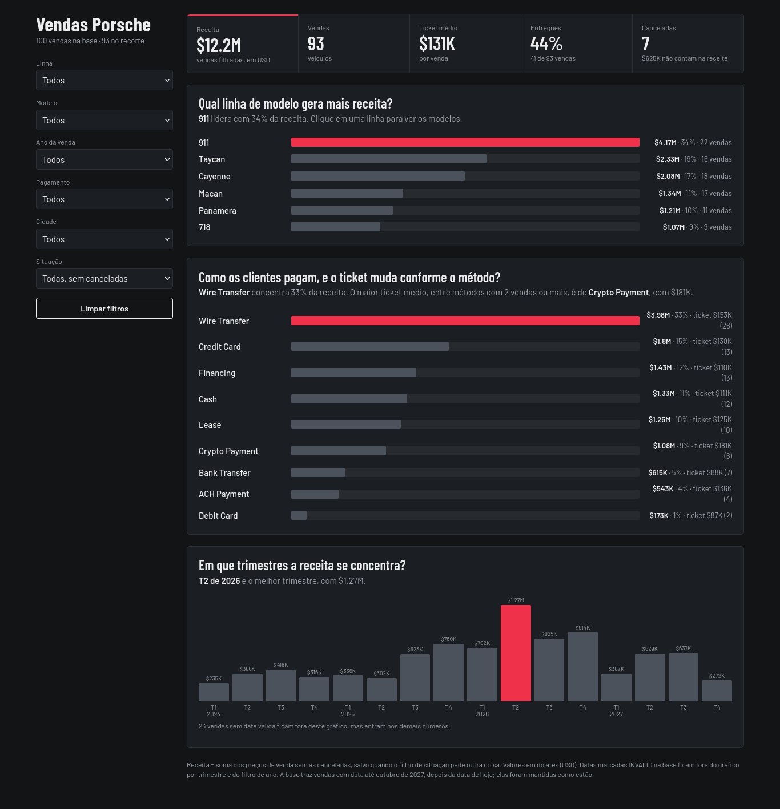
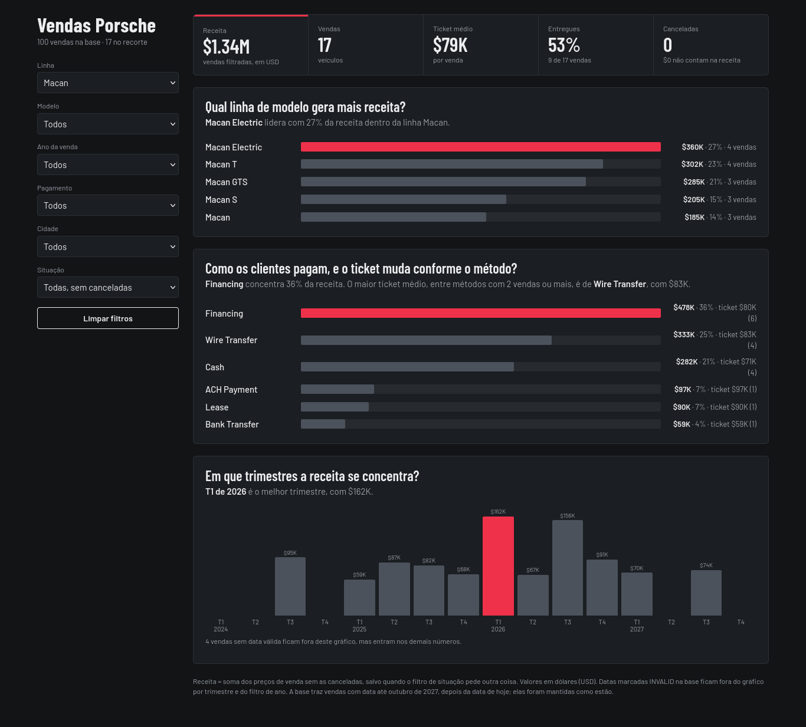

# Dashboard de vendas Porsche

Dashboard em HTML de arquivo único que responde a perguntas de negócio sobre 100 vendas de veículos Porsche, com filtros e indicadores de topo.

**Dashboard publicada:** https://9ththelost.github.io/dio-dashboard-da-Porsche/

## Perguntas de negócio

1. **Qual linha de modelo gera mais receita?** Mostra onde o negócio concentra faturamento (911, Cayenne, Macan, Panamera, Taycan, 718). Ao clicar numa linha, o gráfico passa a mostrar os modelos dela. É a pergunta de portfólio: o que vale priorizar em estoque e comunicação.
2. **Como os clientes pagam, e o ticket muda conforme o método?** Em vendas de alto valor, o método de pagamento afeta caixa e risco. O gráfico traz receita, participação e ticket médio por método.
3. **Em que trimestres a receita se concentra?** Mostra sazonalidade e ritmo de vendas ao longo de 2024 a 2027, com o melhor trimestre em destaque.

**Indicadores de topo:** receita, vendas, ticket médio, % de entregues e canceladas.
**Filtros:** linha, modelo, ano da venda, método de pagamento, cidade e situação.

### Exemplo de filtro aplicado

Com a linha **Macan** selecionada, os indicadores, o ranking de modelos, os métodos de pagamento e os trimestres passam a refletir só essas vendas.

## Prompt usado

> Uma dashboard em HTML, arquivo único, que responda perguntas de negócio sobre as vendas e fique no ar com link próprio.
> - Três perguntas de negócio escolhidas por você, cada uma respondida por um gráfico ou indicador;
> - Filtros que deixem recortar os dados, como modelo, cidade, ano ou método de pagamento;
> - Indicadores de topo, como total de vendas e receita;
> - Um visual coerente, com a paleta e a tipografia que você escolheu.

A planilha foi enviada junto com o prompt.

### O que mudou até a versão final

Esta versão saiu de um único prompt, sem rodadas de ajuste. As decisões abaixo foram tomadas pela IA a partir do prompt e da base:

- Receita e vendas **não contam as canceladas**, que aparecem num indicador separado. O filtro de situação permite incluí-las.
- As 10 situações de entrega foram agrupadas em 4: Entregue, Em entrega, Pendente e Cancelada.
- O filtro de modelo depende da linha escolhida, porque a base tem 41 modelos.
- Visual inspirado na Porsche: vermelho Guards Red como único destaque sobre cinza, tipografia Barlow e Barlow Condensed, modo claro e escuro automáticos.

<!-- Se você pediu ajustes depois, descreva aqui o que mudou entre a primeira e a última versão. -->

## Tratamento da base antes da IA

A planilha original tinha dados sujos em todas as colunas. Ela veio com uma coluna tratada ao lado de cada original (sufixo `Sanitized`), e a dashboard usa só as tratadas:

| Coluna | Problema na origem | Tratamento |
|---|---|---|
| Data da venda | Formatos misturados (`03/14/2024`, `Dec 25th 2024`, `2024.07.11`) e datas impossíveis (`2024-02-30`) | Padronizada em `AAAA-MM-DD`. 24 registros com data impossível ficaram como `INVALID` |
| Preço | `$121k`, `USD 112.750`, `$89.750,00`, `68.900 dollars` | Convertido para número em dólares |
| Quilometragem | `zero miles`, `KM 18,900`, `1.200 mi` | Convertida para milhas. Não é usada na dashboard |
| Pagamento | `wire transfer`, `bank wire`, `bank-transfer` | Unificado em 9 métodos |
| Cidade e estado | `boston`, `ma`, `Washington` | Capitalização e siglas padronizadas |
| Situação | `delivered!!!`, `DELIVERD` | Unificada em 10 situações |

**Registros `INVALID`:** os 24 ficam fora do gráfico por trimestre e do filtro de ano, mas entram nos demais números. A dashboard avisa isso na tela.

**Dados no HTML:** como a base vai embutida no arquivo, só entram modelo, preço, método de pagamento, cidade, estado, situação e mês da venda. Nomes de clientes e vendedores e o `sale_id` ficaram de fora.

**Datas futuras:** a base traz vendas com data até outubro de 2027. Foram mantidas como estão.

## Ferramenta

Usei o **Claude** (Anthropic) no chat, com análise da planilha e geração do HTML. Não usei ChatGPT com Canvas nem agente com skill.

## Arquivos

- `index.html`: a dashboard, com dados e código embutidos
- `README.md`: este documento
- `prints/dashboard-geral.png`: tela sem filtro
- `prints/dashboard-filtro.png`: tela com a linha Macan selecionada
